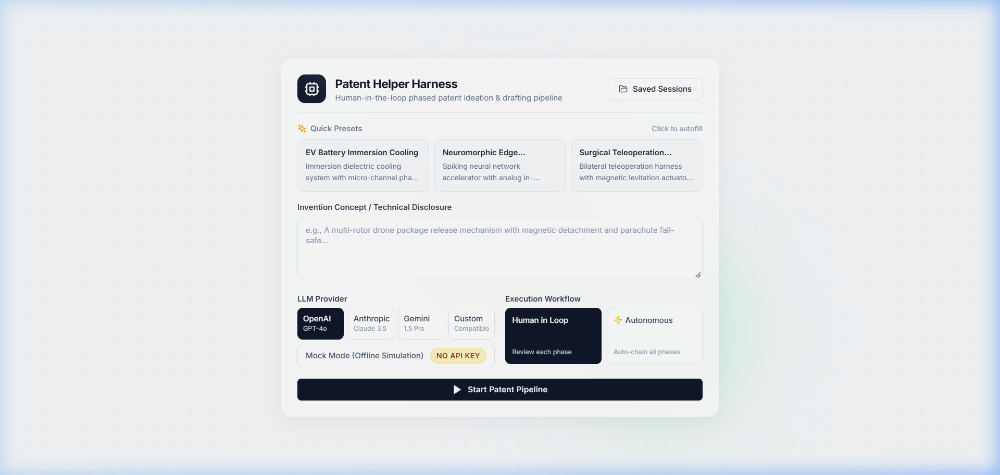
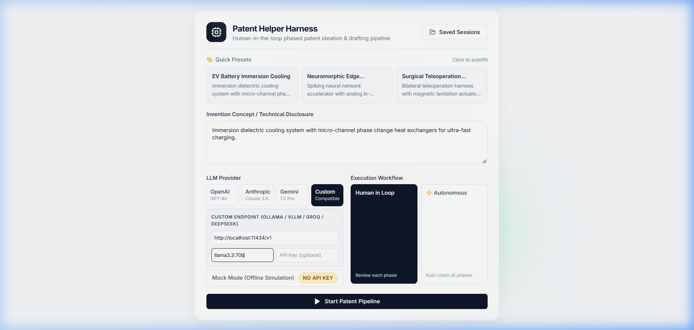
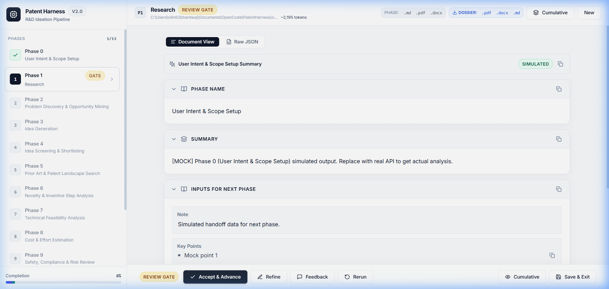
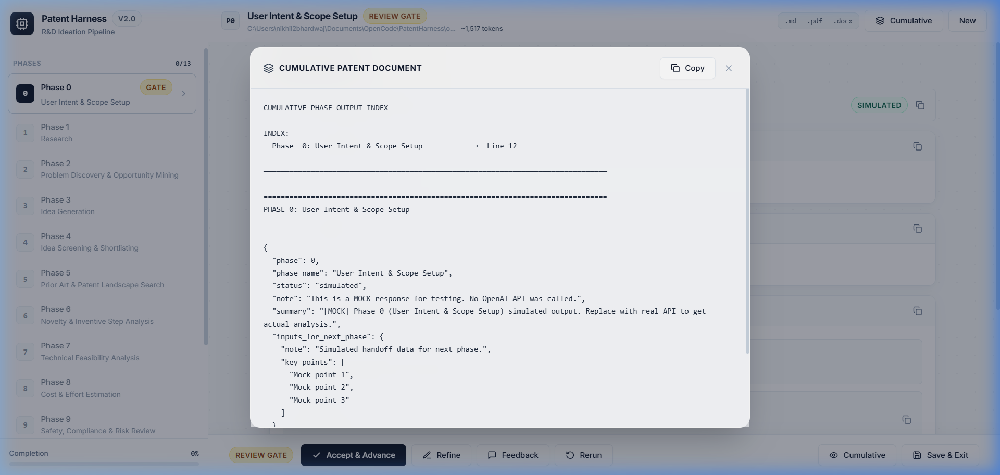

# Patent Helper Harness 📜⚡

[](https://www.python.org/downloads/)
[](https://fastapi.tiangolo.com)
[](https://react.dev)
[](https://vitejs.dev)
[](tests/)
[](LICENSE)

An agentic, human-in-the-loop patent drafting and technical ideation harness. Chaining **13 specialized prompt phases** (Phases 0 through 12), the harness guides inventors from raw concept seeds all the way to complete, audit-validated invention disclosures with claims, prior art matrices, and multi-format document exports (`.pdf`, `.docx`, `.md`).

Equipped with both a rich terminal CLI and a modern, ambient-styled React web application.

---

## 🌟 Key Features

- **13-Phase Human-in-the-Loop Pipeline:** Rigorous progression across research, opportunity mining, claim formulation, feasibility, compliance, and cross-consistency checks.
- **Interactive Review Gates:** Full human steering after every phase:
  - **Accept:** Advance immediately to the next phase.
  - **Edit:** Inline modification of structured JSON or markdown drafts.
  - **Feedback:** Inject targeted directives that prepended into the next phase prompt.
  - **Rerun / Exit:** Regenerate with adjusted parameters or save session checkpoints to resume later.
- **Dual Interface:**
  - **Lively Web UI (React/Vite + Tailwind):** Warm, high-contrast document view with live token metrics, elapsed timer, skeleton shimmers, claim badges, and interactive cumulative modal.
  - **Rich Terminal CLI:** Color-coded tables, markdown rendering, and interactive command prompts.
- **Multi-Provider LLM Architecture:** Enterprise support for **OpenAI** (GPT-4o), **Anthropic** (Claude 3.5 Sonnet), **Google Gemini** (1.5 Pro), and any **OpenAI-Compatible** endpoint (local Ollama, vLLM, DeepSeek, Groq, LMStudio), plus in-UI API key entry and zero-cost **Mock API Client** for offline development.
- **Smart Context Compression:** Automatically compresses preceding phase outputs (reducing token consumption by 60–80%) while maintaining historical continuity for semantic cross-checks.
- **Enterprise-Grade Multi-Format Export:** Export both individual phase deliverables and the **complete multi-phase cumulative patent disclosure dossier** directly to **PDF** (formatted with sanitized clean typography), **Microsoft Word (`.docx`)**, or **Markdown (`.md`)** via 1-click header buttons and the Cumulative modal.
- **Battle-Tested Resilience:** Automated pytest test suite covering edge-case boundaries, path traversal defense, and 20-client high-concurrency stress testing.

---

## 📸 Application Preview

<p align="center">
  
  <br/>
  <em>Lively ambient light theme with preset selector, professional LLM provider toggles (OpenAI, Anthropic, Gemini, Custom), and in-UI API key entry with password toggle</em>
</p>

<p align="center">
  
  <br/>
  <em>Custom Endpoint drawer for local LLMs (Ollama, vLLM, DeepSeek, LMStudio) with custom Base URL and model targeting</em>
</p>

<p align="center">
  
  <br/>
  <em>Human-in-the-loop workspace: 13-phase stepper, high-contrast claim reader, docked Review Gate, and 1-click Phase & Cumulative Dossier export buttons</em>
</p>

<p align="center">
  
  <br/>
  <em>Cumulative multi-phase patent dossier modal with Document View formatting, raw JSON toggle, and 1-click publication export (.pdf, .docx, .md)</em>
</p>

---

## 🔄 The 13 Innovation Phases

| Phase | Title | Focus & Core Output |
| :---: | :--- | :--- |
| **0** | **User Intent & Scope Setup** | Classifies input concept, identifies technical domain, sets research boundaries. |
| **1** | **Prior Art & Market Research** | Synthesizes technology trends, existing patents, regulatory signals, and market drivers. |
| **2** | **Problem Discovery & Opportunity** | Formulates precise technical pain points and unmet engineering gaps. |
| **3** | **Idea Generation & Brainstorming** | Generates 2–5 distinct patentable concept candidates per problem. |
| **4** | **Idea Screening & Shortlisting** | Ranks concepts across 11 weighted patentability and defensibility factors. |
| **5** | **Patent Landscape Search** | Formulates Boolean search strings, keyword matrices, and direct prior art mappings. |
| **6** | **Novelty & Inventive Step Analysis** | Detailed feature breakdown proving non-obviousness over nearest prior art. |
| **7** | **Technical Feasibility Analysis** | Evaluates hardware, software, calibration, and integration requirements. |
| **8** | **Cost & Effort Estimation** | T-shirt sizing, work breakdown structure (WBS), and resource modeling. |
| **9** | **Safety, Compliance & Risk Review** | Regulatory compliance (e.g. ISO 26262, cybersecurity, safety) and risk mitigations. |
| **10** | **Invention Disclosure Drafting** | Full disclosure draft: Abstract, Independent Claims, Dependent Claims, and Embodiments. |
| **11** | **Fact-Checking & Audit Validation** | Audits Phase 10 against historical search matrices; flags overclaims or hallucinations. |
| **12** | **Executive Recommendation & Strategy**| Final IP recommendation, filing roadmap, defense strategy, and cumulative compilation. |

---

## 🚀 Quickstart Guide

### 1. Prerequisites
- **Python 3.10+**
- **Node.js 18+** *(optional, only needed if modifying frontend source code; pre-built bundle is included)*

### 2. Installation

Clone repository and set up a virtual environment:

```bash
git clone https://github.com/your-username/PatentHarness.git
cd PatentHarness

# Create and activate virtual environment
python -m venv .venv
source .venv/bin/activate  # On Windows: .venv\Scripts\activate

# Install dependencies
pip install -r requirements.txt
```

### 3. Environment Configuration

Copy `.env.example` to `.env` and provide your API keys:

```bash
cp .env.example .env
```

Edit `.env` with your preferred credentials:
```env
# Provider Selection: "openai", "anthropic", "gemini", or "openaicompatible"
API_PROVIDER=openai

# 1. OpenAI
OPENAI_API_KEY=your_openai_key_here
OPENAI_MODEL=gpt-4o

# 2. Anthropic
ANTHROPIC_API_KEY=your_anthropic_key_here
ANTHROPIC_MODEL=claude-3-5-sonnet-20241022

# 3. Google Gemini
GEMINI_API_KEY=your_gemini_key_here
GEMINI_MODEL=gemini-1.5-pro

# 4. OpenAI-Compatible (Ollama, vLLM, DeepSeek, Groq, LMStudio)
OPENAI_COMPATIBLE_BASE_URL=http://localhost:11434/v1
OPENAI_COMPATIBLE_MODEL=llama3.3:70b
```

*(Note: You can run everything in **Mock Mode** without any API key by passing `--mock` or checking Mock Mode in the UI).*

---

## 🖥️ Running the Application

### Option A: Modern Web Application (Recommended)

1. **Start the FastAPI backend server:**
   ```bash
   uvicorn web.backend.main:app --host 127.0.0.1 --port 8000 --reload
   ```

2. **Open in Browser:**
   Navigate to [http://127.0.0.1:8000](http://127.0.0.1:8000). The pre-built production bundle will be served automatically.

*(Optional) To run the Vite hot-reloading development server:*
```bash
cd web/frontend
npm install
npm run dev
```

---

### Option B: Terminal CLI

1. **Launch a new session:**
   ```bash
   python run_harness.py
   ```
   *Enter your invention concept or press Enter for Autonomous mode.*

2. **Launch with Mock API (Instant, zero cost):**
   ```bash
   python run_harness.py --mock
   ```

3. **Specify Provider and Model:**
   ```bash
   # OpenAI
   python run_harness.py --provider openai --model gpt-4o

   # Anthropic Claude
   python run_harness.py --provider anthropic --model claude-3-5-sonnet-20241022

   # Google Gemini
   python run_harness.py --provider gemini --model gemini-1.5-pro

   # Local / Custom OpenAI-Compatible (Ollama / vLLM / DeepSeek)
   python run_harness.py --provider openaicompatible --base-url http://localhost:11434/v1 --model llama3.3:70b
   ```

4. **Resume an existing session checkpoint:**
   ```bash
   python run_harness.py --resume outputs/session_20261012_190512/
   ```

---

## 🧪 Testing & Verification

The repository includes a comprehensive, industry-grade test suite covering core unit mechanics, API boundaries, export validation, and high-concurrency load testing.

Run all tests:
```bash
pytest -v
```

Run specific test suites:
```bash
# Core Unit & High-Concurrency Stress Tests (20 parallel clients)
pytest -v tests/test_harness_stress.py -s

# End-to-End 13-Phase Pipeline Chaining Test
pytest -v tests/test_e2e_full_chain.py -s
```

---

## 📁 Repository Structure

```text
PatentHarness/
├── Innovation Prompts/     # 13 Phase prompt templates + System prompt
│   ├── 1. SystemPrompt.txt
│   ├── Prompt 0.md ... Prompt 12.txt
├── harness/                # Core Python orchestration engine
│   ├── api_client.py       # OpenAI / Groq API adapter with retry & SSL handling
│   ├── config.py           # Configuration, models, and threshold constants
│   ├── mock_client.py      # Simulated LLM client for offline validation
│   ├── output_store.py     # Session persistence, cumulative indexer, exports
│   ├── prompt_loader.py    # Template parser and variable substituter
│   ├── utils.py            # Token counting & context compression
│   └── workflow.py         # Human-in-the-loop CLI gate controller
├── web/                    # Fullstack web application
│   ├── backend/            # FastAPI REST API & document export services
│   │   └── main.py
│   └── frontend/           # React + Vite + Tailwind CSS application
│       ├── src/
│       │   ├── App.jsx            # Main app with Review Gate & Stepper
│       │   ├── ReadableOutput.jsx # Clean document reader with claim badges
│       │   └── index.css          # Design system & lively ambient gradients
│       └── dist/                  # Pre-compiled static production assets
├── tests/                  # Pytest test suite
│   ├── test_harness_stress.py # Unit, resilience, bounds, and concurrency tests
│   └── test_e2e_full_chain.py # Sequential 13-phase chain integration test
├── docs/images/            # Application preview screenshots
├── outputs/                # Session checkpoints (git-ignored)
├── run_harness.py          # CLI entry point
├── requirements.txt        # Python dependencies
├── pytest.ini              # Pytest asyncio configuration
├── .env.example            # Environment variables template
└── README.md               # Project documentation
```

---

## 🛡️ License

This project is licensed under the MIT License - see the [LICENSE](LICENSE) file for details.
